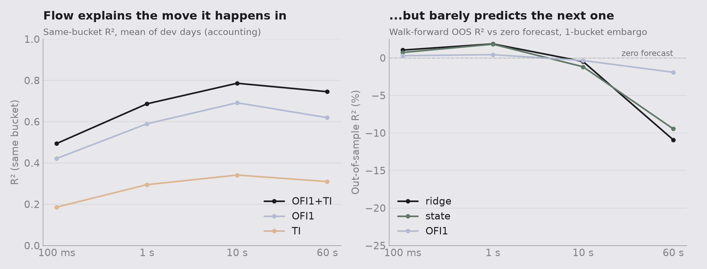
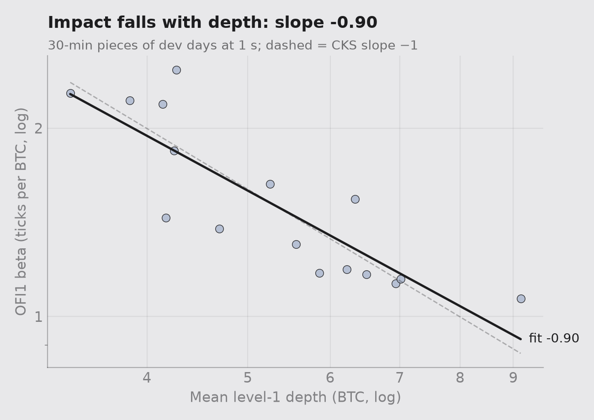
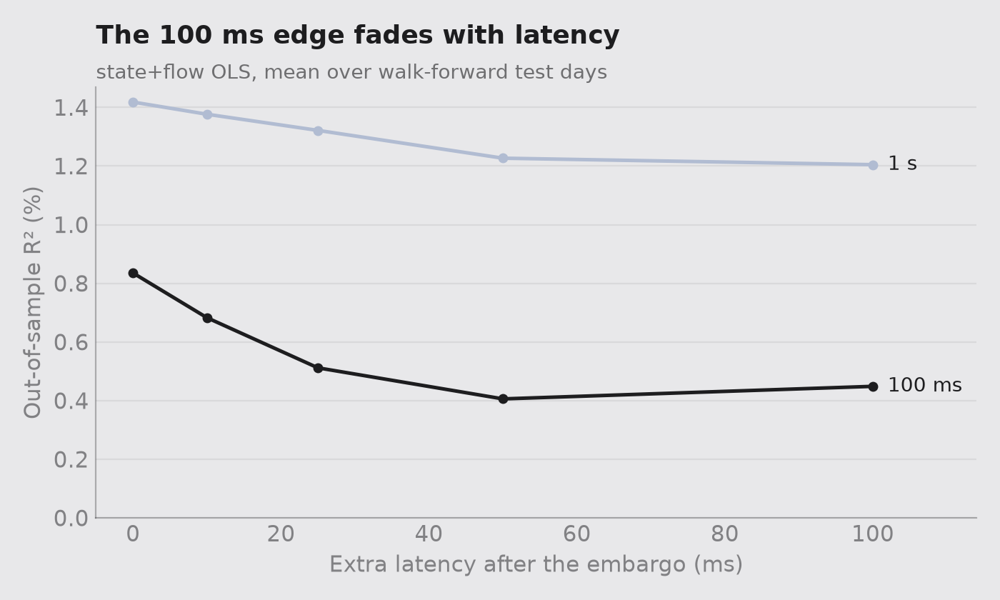
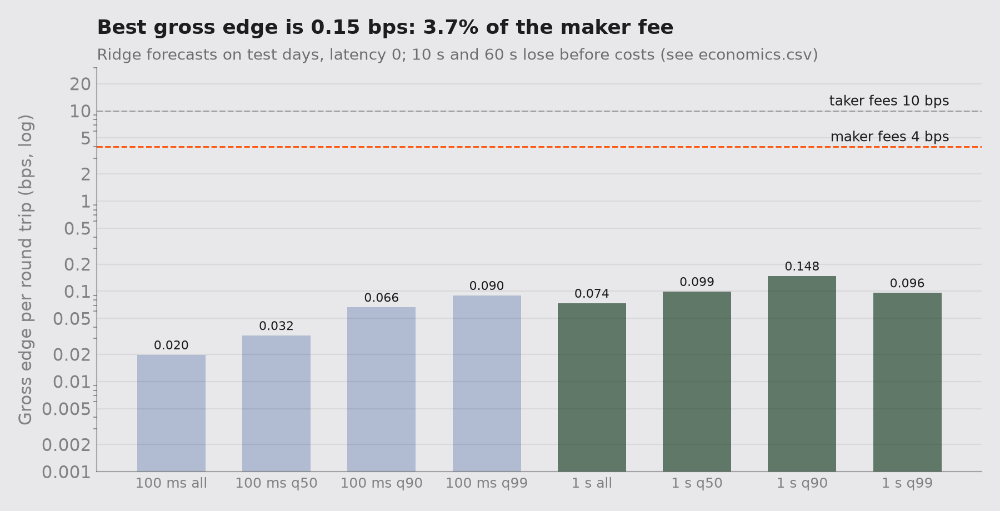

# order-flow-imbalance

Event-level multi-level order flow imbalance on Binance BTCUSDT perps, built on [l2-orderbook-replay](https://github.com/Rubin-S/l2-orderbook-replay).

> **Status:** v1 complete. Pre-registered 2026-10-18 (tag prereg-v1), frozen (freeze-v1), holdout run once (holdout-v1). Every holdout number below is reported as it came out.

## Reproduce

```bash
git clone --recurse-submodules https://github.com/Rubin-S/order-flow-imbalance.git
cd order-flow-imbalance
python3 -m venv .venv && .venv/bin/pip install -r requirements.txt
make data features      # builds the pinned engine, streams 7 days, writes data/feat_*.parquet
```

`results/data_checksums.txt` lists the sha256 of every `.evt` file. `results/day_summary.csv` is the per-day data audit.

## Results

**In one line:** order flow explains about 60% of a 1-second BTC perp mid move after the fact, but predicts only about 1% of it ahead of time. That edge, about 0.1 bps a trade, covers 2 to 4% of even the cheapest fee. It's real, it survived a pre-registered holdout, and it isn't tradable at VIP 0.



### Headline: dev vs holdout

| Test (pre-registered) | Dev: walk-forward, May–Jul | Holdout: Aug–Oct, run once |
|---|---|---|
| Ridge vs zero, 100 ms (R² gain, pp) | +1.28 [0.21, 2.11] ✔ | +0.32 [0.06, 0.70] ✔ |
| Ridge vs zero, 1 s | +1.16 [0.78, 1.61] ✔ | +1.07 [0.51, 1.59] ✔ |
| Q3 flow over state, 100 ms | +0.09 [−0.16, 0.30] | +0.33 [0.23, 0.42] ✔ |
| Q3 flow over state, 1 s | −0.10 [−0.26, 0.04] | +0.01 [−0.07, 0.09] |
| Q2 OFI10 vs OFI1, 1 s | −0.12 [−0.19, −0.04] | −0.05 [−0.16, 0.02] |
| Q2 integrated vs OFI1, 1 s | −0.21 [−0.35, −0.05] | −0.06 [−0.20, 0.07] |
| Q5 gross edge, 1 s, q90 (bps/trade) | 0.148 [0.117, 0.182], 2,275 trades | 0.085 [0.058, 0.112], 820 trades |
| Q5 share of the 4 bps maker fee | 3.7% | 2.1% |
| *Ridge R², mean of per-day values, 100 ms / 1 s* | *1.04% / 1.86%* | ***−1.95% / −0.28%*** |

[95% CI] from a 5-minute moving-block bootstrap within each test day (2,000 resamples, seed 20261018). ✔ = lower bound > 0, the pre-registered pass rule. R² rows are **pooled**: 1 − ΣSSE / Σy² over all test buckets, the statistic frozen in tag `freeze-v1`. The last row is the simple mean of per-day R², shown because it disagrees (see *The holdout, honestly*). Seven tests, no multiple-comparison correction.

### Q1. Contemporaneous impact
ΔP ≈ β·OFI holds on every dev day: β runs 1.18 to 2.16 ticks per unit, with HAC t-stats 27 to 47. At 1 s, R² is 0.590 for OFI₁, 0.295 for trade imbalance alone and 0.686 for both. β falls with depth with a log-log slope of −0.90 across 16 day-horizon pieces, close to the −1 that CKS predict.



### Q2. Depth
In a big-tick book (the spread is one tick 99.6–100% of the time), level 1 decides the next move. Raw OFI₅ edges up contemporaneous R² (0.605 vs 0.590), but OFI₁₀ (0.596) doesn't, and depth-normalised (N₁ 0.527) and PCA-integrated OFI (0.446) come out **lower**. Out of sample, OFI₁ was significantly better than OFI₁₀ and integrated OFI on dev, and no different on the holdout. Deeper levels add noise, not signal.

### Q3. Flow vs state
At 1 s, lagged OFI adds nothing over queue imbalance and microprice on dev or holdout. At 100 ms it passed on the holdout (+0.33 pp), which I did **not** predict. Both models had negative mean R² there, so the likelier reading is that flow offset some of the state model's error on Aug 1 rather than adding new signal. It's untested, so treat it as a lead for v2, not a finding.

### Q4. Decay
Forecast R² is positive at 100 ms and 1 s and negative at 10 s and 60 s, on every split. Latency hurts fast: on dev, the 100 ms state+flow R² drops from 0.84% to 0.45% with 100 ms of delay.



### Q5. Economics
The frozen headline (ridge, 1 s, latency 0, trade when |forecast| beats the training q90) earns 0.148 bps gross per trade on dev and 0.085 bps on holdout. Fees are 4 bps (maker) and 10 bps (taker) per round trip, 270–300 and 670–750 ticks, against an edge of 6 to 11 ticks per trade. **Neither a taker nor a maker breaks even.** A real maker is also adversely selected: resting orders fill just before the price moves through them.



### The holdout, honestly
The pooled edge passes, but the mean of per-day R² is negative, because **Aug 1 failed** (ridge −7.9% at 100 ms, −4.0% at 1 s; Sep and Oct were +0.9 to +1.6%). A post-hoc diagnostic (`scripts/diag_holdout.py`, written *after* the run, which changes no result) shows why:

- **Aug 1 was quiet.** ΔP's standard deviation was 3.6 ticks at 100 ms vs 8.3–9.2 on Sep and Oct, so it carries only 8–9% of the pooled weight, against a third in the day-mean.
- **The direction was right.** corr(forecast, ΔP) was +0.09 / +0.10 on Aug 1 vs +0.12 / +0.13 on the others.
- **The size was wrong.** Forecasts kept roughly the same spread on every day, so on the quiet day they were too big: sd(forecast)/sd(ΔP) = 0.39 vs about 0.17. With ρ the correlation and k that ratio, R² ≈ 2ρk − k², which reproduces the reported numbers (−7.9% on Aug 1, +1.1% on Sep). The best possible k is ρ, giving R² = ρ² ≈ 1–1.7%.

So the signal ranks moves consistently, but its forecasts don't shrink when the market goes quiet. That is a calibration failure, not a sign failure, and three days can't say how often it happens.

### Priors scorecard
| # | Prior | Verdict |
|---|---|---|
| 1 | β > 0 on every day | ✔ confirmed |
| 2 | Contemporaneous R² rises with depth; small OOS gain | ✘ / ✔ depth didn't help contemporaneously either; OFI₁ wins OOS |
| 3 | Lagged OFI adds little over state at ≤ 1 s | ✔ at 1 s; open question at 100 ms (holdout pass) |
| 4 | Forecast R² ≈ 0 by 60 s | ✔ negative from 10 s |
| 5 | A taker can't beat fees; any edge belongs to a maker | ✔ / ✘ the maker can't beat them either |

### v2, pre-registered (not run)
One change: **volatility-scaled forecasts.** Divide the training target by the trailing 5-minute realised sd of ΔP (past buckets only), fit the same frozen models, and multiply each forecast by the same trailing sd. Everything else stays as in `freeze-v1`. It will be tested on **new** first-of-month days (Nov 2026 to Jan 2027) under the same pass rule. The idea came from Aug 1, so testing it on Aug–Oct would prove nothing.

### Limitations
- 7 days, one 2-hour window (00:00–02:00 UTC) each, one asset. The holdout is N = 3 days, whatever the bucket count.
- The bootstrap holds the fitted model fixed: it leaves out training-fit, α and PCA-weight uncertainty, and regime shifts beyond these days.
- There's no fill model: no queue position, no adverse selection, and trades are marked at mid.
- Fold 1's ridge α was chosen on the last 25% of April, because there was no separate validation day.
- Figure 3 shows only horizons with a positive edge; 10 s and 60 s are disclosed in its subtitle.

## Pre-registration

Fixed on 2026-10-18, before fitting any forecasting model. The git timestamp of this commit (tag `prereg-v1`) is the proof.

### Research questions

- **Q1. Contemporaneous impact.** Does ΔP ≈ β·OFI hold on BTC perps (Cont, Kukanov & Stoikov 2014), and does β fall as average depth rises?
- **Q2. Depth.** Do deeper levels (L1 → L5 → L10 → PCA-integrated OFI) raise contemporaneous R², and do they raise out-of-sample forecast R²?
- **Q3. Flow vs state.** Does lagged OFI add forecasting power on top of queue imbalance and microprice?
- **Q4. Decay.** How fast does forecasting power fade with horizon (100 ms → 60 s) and with latency (0 → 100 ms)?
- **Q5. Economics.** What cost per round trip would the best forecast break even at, and is that above or below Binance fees for a taker and for a maker?

### My priors (written down so I can be wrong in public)

1. β > 0 on every day.
2. Contemporaneous R² rises with depth. Out-of-sample gains from deeper levels are small, because BTCUSDT is a big-tick book (the spread is one tick 99.6 to 100% of the time), so the next move is decided at level 1.
3. Lagged OFI adds little over queue imbalance at ≤ 1 s.
4. Forecast R² is close to zero by 60 s.
5. A taker cannot beat fees. Any edge belongs to a maker.

### Data

- **Source:** Tardis free first-of-month files, `binance-futures`, `incremental_book_L2` + `trades`, BTCUSDT.
- **Days:** the 1st of each month, Apr to Oct 2026, window **00:00 to 02:00 UTC** every day.
- **Development days:** Apr, May, Jun, Jul. **Holdout days:** Aug, Sep, Oct. Every holdout number gets reported, whatever it says, from a single run of frozen code.
- **Masks:** rows flagged `reset_flag` (book rebuilt after a reconnect) and the first **60 s** after 00:00 UTC (funding settlement). Flow is never computed across a reset.
- **Feed regime:** Binance pushed book updates about every **52 ms** on Apr and May and every **26 ms** from June on (`results/day_summary.csv`). All horizons are in clock time, never "next N messages", and results are reported per regime as well as pooled.

### Method

- **Buckets:** Δt ∈ {100 ms, 1 s, 10 s, 60 s}. OFI is summed over each bucket; mid is the last value at or before the bucket end; ΔP is measured in **ticks** (0.1 USDT).
- **Clocks:** the exchange timestamp for contemporaneous accounting, and the local (capture) timestamp for anything predictive: a feature may only use rows with `ts_local` ≤ the decision time.
- **Depth normalisation:** OFI at depth m is divided by the average depth of levels 1..m over the **previous** bucket, so no same-bucket information leaks in.
- **Integrated OFI:** PCA on normalised L1..L10 OFI, fit on **training days only**; weights normalised to sum to 1.
- **Contemporaneous specs:** OLS of ΔP on OFI₁, trade imbalance, OFI₁ + trade imbalance, OFI₅, OFI₁₀ and integrated OFI, with Newey–West (HAC) errors.
- **Forecast target:** ΔP over the next bucket, skipping one bucket as an embargo.
- **Forecast features:** lagged OFI (L1, L5, L10, integrated), level-1 queue imbalance, `imbalance5`, microprice − mid, recent ΔP.
- **Baselines (reported first):** a zero forecast, and recent ΔP only.
- **Models:** OLS and ridge (α chosen on the last training day only).
- **Out-of-sample R²:** 1 − SSE(model) / SSE(zero forecast). Zero means no better than predicting "no move".
- **Walk-forward on dev:** train Apr → test May; Apr–May → Jun; Apr–Jun → Jul.
- **Holdout:** train on all 4 dev days, test Aug, Sep, Oct, once.

### Pass rule

Model A beats model B only if the 95% confidence interval of **R²_oos(A) − R²_oos(B)** excludes zero. The interval comes from a moving-block bootstrap on the holdout days, with 5-minute blocks resampled within each day and 2,000 resamples. Blocks keep the autocorrelation that a plain row bootstrap would ignore. Three holdout days are too few blocks on their own.

### Costs

Binance USDⓈ-M VIP 0 fees: **0.02% maker, 0.05% taker** per side (checked 2026-10-18), i.e. 4 bps maker and 10 bps taker per round trip, before spread. Economics are reported gross, after the spread, and after fees, together with the break-even cost at each horizon.

### Disclosures

- The Oct 1, 00:00–00:39 UTC sample was used to build and test the engine before this split was fixed. It produced only contemporaneous sanity numbers (same-second R² 0.48–0.54), not forecasts.
- The holdout files were downloaded and audited for data quality only (row counts, resets, message cadence, spread). No OFI-to-return statistics have been computed on Aug, Sep or Oct.

### Addendum: frozen before the holdout (tag `freeze-v1`)

Added after the development analysis and before any model touched Aug, Sep or Oct.
It fixes choices the original pre-registration left open. Nothing below changes after the holdout run.

- **Frozen code:** `forecast.py`, `economics.py`, `bootstrap.py` and `figures.py` at this tag. The holdout is one run of `forecast.py --holdout`, `economics.py --holdout` and `bootstrap.py --holdout`.
- **Comparisons tested** (pass rule above, 95% CI of the R² difference excludes 0):
  1. Edge: ridge vs zero forecast at 100 ms and 1 s.
  2. Q3: state+flow vs state (OLS) at 100 ms and 1 s.
  3. Q2 out-of-sample: OFI10 vs OFI1, and integrated OFI vs OFI1, at 1 s.
- **Q5 headline:** ridge, 1 s, latency 0, trading only when |forecast| beats the training q90. It was chosen on dev because it is the best row with over 1,000 trades. It "pays" only if its bootstrap CI lower bound beats the 4 bps maker round trip. Every other economics row is exploratory.
- **Multiple comparisons:** six R² tests plus one economics test, reported without correction; read a single marginal pass with that in mind.
- **Disclosure:** for the first dev fold (Apr → May) there is no separate validation day, so ridge α is chosen on the chronologically last 25% of Apr 1. Every other fold, and the holdout, uses the last training day.
- **Figure 3** shows only horizons with positive OOS R² (100 ms, 1 s); every row is in `results/economics.csv`.
